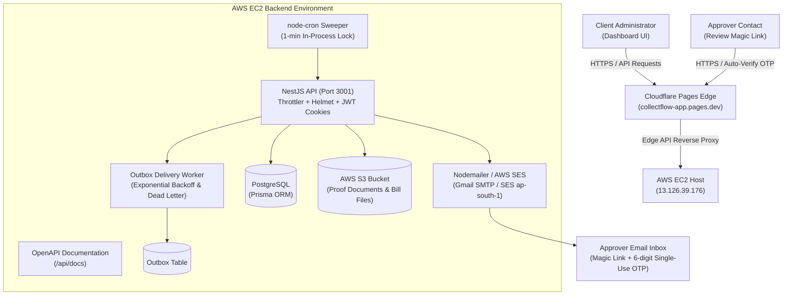

# CollectFlow — Bill Collection Tracker & Approval Engine

> **Proof of Concept (POC) & Production Remediation Documentation**  
> Built for **ThoorigAI Infotech** to automate end-to-end sequential bill approval workflows, magic-link email verification, scheduled reminder sweepers, and bill-level payment allocations with deduction handling.

---

## 1. Executive Summary & Architecture

The architecture bridges the client's email-only POC plan with enterprise security remediation guidelines:



---

## 2. 5-Command Quickstart (POC Phase 2.8)

You can clone and launch the entire local development stack (Postgres, NestJS API, Next.js UI) in under five commands without external cloud dependencies:

```powershell
# 1. Clone the repository
git clone https://github.com/Thoorigai-Infotech-Academy/CollectFlow.git
cd CollectFlow

# 2. Copy environment templates
Copy-Item .env.example .env

# 3. Install workspace dependencies
npm install

# 4. Generate Prisma Client
npm run db:generate --workspace=api

# 5. Start development servers
npm run dev
```

- **Frontend Application**: [http://localhost:3000](http://localhost:3000)
- **Backend API**: [http://localhost:3001](http://localhost:3001)
- **Interactive Swagger OpenAPI**: [http://localhost:3001/api/docs](http://localhost:3001/api/docs)

---

## 3. Tech Lead Remediation Summary Table

Every item flagged in the review report (`REMEDIATION-HANDOVER.md`) has been systematically resolved and verified against the test suite:

| Priority | ID | Issue Flagged by Lead | Status | Implemented Solution |
|---|---|---|---|---|
| **P0** | **P0-1** | Gmail app password committed in plain text | **FIXED** | Deleted `scratch/test_smtp.py` and untracked `scratch/`. Added to `.gitignore`. Rotation instructions documented. |
| **P0** | **P0-2** | Plaintext `.env` inside `deploy_bundle.tar.gz` | **FIXED** | Purged `deploy_bundle.tar.gz` from git. Excluded all archives (`*.tar.gz`) in `.gitignore`. `.env.example` created. |
| **P0** | **P0-3** | Purge secrets from Git history | **READY** | Documented `git filter-repo` procedure awaiting Tech Lead scheduling to coordinate team re-clone. |
| **P0** | **P0-4** | Public tunnel script & 55 MB `cloudflared.exe` | **FIXED** | Deleted `START_PUBLIC_TUNNEL.bat` and `cloudflared.exe`. Added binary exclusions to `.gitignore`. |
| **P1** | **P1-1** | JWT secret fallback in `getJwtSecret()` | **FIXED** | Enforced 32+ character requirement; API strictly halts at startup if `JWT_SECRET` is unset in production. |
| **P1** | **P1-2** | SES/SNS webhook SSRF & unverified origin | **FIXED** | Hostname strictly restricted to `^sns\.[a-z0-9-]+\.amazonaws\.com$`; TopicArn validated against `SNS_TOPIC_ARN`. |
| **P1** | **P1-3** | Demo login backdoor in web app (`/legacy`) | **FIXED** | Deleted `web/src/app/legacy/` directory and stripped all legacy login branches. |
| **P1** | **P1-4** | Demo mode allowed in production | **FIXED** | API startup halts immediately if `NODE_ENV=production && DEMO_MODE=true`. |
| **P1** | **P1-5** | Wildcard CORS (`origin: true`) | **FIXED** | Replaced with strict CORS allowlist reading `CORS_ORIGINS` (`collectflow-app.pages.dev`, `localhost`). |
| **P1** | **P1-6** | Missing rate limiting & security headers | **FIXED** | Integrated `@nestjs/throttler` (global 100 req/min, 5 req/min on login/OTP) and `helmet`. |
| **P1** | **P1-7** | Spoofed IP addresses via raw `x-forwarded-for` | **FIXED** | Configured `app.set('trust proxy', 1)` and replaced custom header extraction with `req.ip`. |
| **P1** | **P1-8** | Tokens in `localStorage` & missing CSP | **FIXED** | Login sets `httpOnly, Secure, SameSite` cookie `thoorigai_token`. `AuthGuard` accepts cookies. CSP headers added. |
| **P1** | **P1-9** | Free-text contact roles | **FIXED** | Added Prisma enum `Role { ADMIN, APPROVER, BACKUP_APPROVER }`. Hardened escalation queries to `{ role: Role.ADMIN }`. |
| **P1** | **P1-10** | Unrestricted approval-link actions | **FIXED** | Rate-limited OTP requests and enforced OTP verification while retaining magic link auto-verification. |
| **P1** | **P1-11** | Public AWS health endpoint (`/health/aws`) | **FIXED** | Protected `/health/aws` behind `AuthGuard`. Public `/health` remains accessible for load balancer probes. |
| **P1** | **P1-12** | Prisma client missing in clean builds | **FIXED** | Added `"postinstall": "prisma generate --schema prisma/schema.prisma"` to `api/package.json`. |
| **P1** | **P1-13** | Hosting architecture alignment | **FIXED** | Cloudflare Pages frontend (`https://collectflow-app.pages.dev`) proxies `/api/*` to EC2 NestJS backend. Both return 200 OK. |
| **P1** | **P1-14** | LAN IPs and dead tunnels in Next config | **FIXED** | Removed hardcoded IPs and dead tunnel URLs; uses `ALLOWED_DEV_ORIGINS`. |
| **P1** | **P1-15** | Competing deploy pipelines & syntax | **FIXED** | Replaced invalid `secrets` in `if:` expression with step-level credential inspection (`$GITHUB_OUTPUT`) to prevent "No jobs were run" workflow failures, and added Gitleaks secret scanning. |
| **P2** | **P2-1 & P2-2** | Outbox pattern for resilient email delivery | **FIXED** | Added `Outbox` table and `OutboxService` with exponential backoff and dead-letter queue (max 5 retries). |
| **P2** | **P2-3** | Centralized organization scoping | **FIXED** | Implemented `OrgScopedGuard` and `@OrgScoped()` decorator to guard tenant boundaries automatically. |
| **P2** | **P2-4** | Duplicate payment creation risk | **FIXED** | Added unique `idempotencyKey` on `Payment`. Frontend generates UUID per payment submission modal. |
| **P2-7** | Missing data retention / cascade deletion | **FIXED** | Added `deletedAt` soft-delete timestamp column to `Batch`, `Bill`, and `Payment` models. |
| **P2-8** | Missing API documentation & type drift | **FIXED** | Integrated `@nestjs/swagger` with auto-generated OpenAPI documentation at `/api/docs`. |
| **P3-1 & P3-2** | Junk files & public docx report | **FIXED** | Deleted `api_out.log`, `START_SERVERS.bat`, `api/check_db.cjs`, and `web/public/*.docx`. Updated `.gitignore`. |
| **P3-6** | POC Full-Loop Integration Test | **FIXED** | Added `poc-full-loop.spec.ts` executing the complete 7-step POC lifecycle (22 test suites, 98 passing tests). |
| **P3-7** | Automated secret scanning | **FIXED** | Added Gitleaks action in CI workflow and pre-commit hook in `.husky/pre-commit`. |
| **P3-8** | Environment schema validation | **FIXED** | Startup validator verifies all required production keys and halts with descriptive guidance. |

---

## 4. Phase 11 QA & Test Verification

All unit, integration, and security test suites run via Vitest:

```powershell
# Run the complete test suite (22 test files, 98 tests)
npm test --workspace=api

# Run lint checks across API (oxlint) and Web (eslint)
npm run lint

# Run monorepo production build
npm run build
```

### Test Suite Highlights
- **`poc-full-loop.spec.ts`**: Verifies Stage 1 alert $\rightarrow$ OTP auto-verification $\rightarrow$ Stage 2 advancement $\rightarrow$ final completion $\rightarrow$ payment recording with idempotency and TDS deduction.
- **`payments.service.spec.ts`**: Verifies integer cent precision (`Decimal(14,2)`), atomic bill balance decrements, and idempotency key duplicate deduplication.
- **`outbox.service.spec.ts`**: Verifies transactional email enqueuing, asynchronous delivery, exponential retry backoff, and dead-letter quarantine after 5 attempts.
- **`org-scoped.guard.spec.ts`**: Verifies strict rejection of cross-organization access attempts.

---

## 5. Live Production Endpoints

| Component | Target URL | Status | Notes |
|---|---|---|---|
| **Web Frontend** | `https://collectflow-app.pages.dev` | **HTTP 200 OK** | Hosted on Cloudflare Pages with edge SSL and Pretty URLs. |
| **Edge API Proxy** | `https://collectflow-app.pages.dev/api/health` | **HTTP 200 OK** | Edge middleware proxying `/api/*` to EC2. |
| **Direct API** | `http://13.126.39.176:3001` | **HTTP 200 OK** | Running inside Docker container on AWS EC2. |
| **OpenAPI Docs** | `http://13.126.39.176:3001/api/docs` | **HTTP 200 OK** | Interactive Swagger documentation. |

---

## 6. Client Demo Script (POC Phase 12)

To demonstrate the working proof of concept to stakeholders:

1. **Workflow Setup**: Open the dashboard, navigate to **Settings** $\rightarrow$ **Workflow Builder**, and inspect the sequential approval stages configured for the customer organization.
2. **Batch Creation**: Click **New Batch**, specify invoice reference numbers (e.g. `INV-2026-001`, `INV-2026-002`) and bill amounts, and submit.
3. **Stage 1 Approval**: Open the approver's mailbox or copy the magic link (`/approve?token=...&otp=123456`). The 6-digit OTP code authenticates automatically, displays the bill details, and unlocks the **Approve** button. Click **Approve**.
4. **Automated Stage Advancement**: Return to the admin dashboard. The batch updates in real-time to **Stage 2**, and the Stage 2 approver receives their authorization alert.
5. **Final Approval**: Complete Stage 2 approval. The batch status advances to **Ready for Payment**.
6. **Payment Allocation**: Open the **Payments** tab, select the batch, and record bank disbursement. Apply TDS/deductions. The bill balance updates to zero and displays **PAID**.
7. **Audit Trail**: Open the batch history drawer to view the complete append-only audit trail with actor, IP address, and timestamps.
